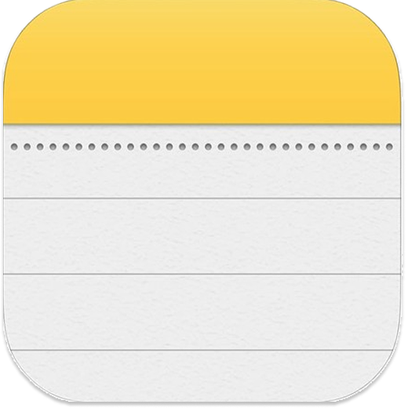

# 📝 Notes — Flutter Note‑Taking App

<div align="center">
  
</div>

## 🔍 Overview

Notes is a lightweight Flutter application to quickly capture, color‑tag, and manage your notes. It
features a clean Material 3 dark theme, responsive layout, and local persistence via Hive — so your
notes stay on device and load instantly.

## ✨ Features

- 🎨 Modern dark UI with custom Poppins typography
- ➕ Create notes with title and content
- ✏️ Edit existing notes
- 🗑️ Delete notes with a tap
- 🎯 Color labels: choose from a curated palette for quick visual grouping
- 💾 Offline-first: fast local persistence using Hive
- 📐 Responsive layout via a small helper (MyResponsive)
- 🔔 Friendly feedback with snackbars
- 🧱 State management with Cubit (flutter_bloc)

## 🏗️ Architecture

Feature-first, layered structure with simple repositories and Cubits:

```
lib/
├── core/
│   ├── helper/           # Responsiveness, snackbars
│   ├── shared_widgets/   # Reusable text fields, buttons, app bar, validators
│   └── utils/            # Theme, colors, constants, strings
└── features/
    ├── home/             # Notes list + delete
    └── add&edit_note/    # Add bottom sheet + Edit view
```

### Patterns & Approach

- Cubit (flutter_bloc) for state management
- Repository wrapper over Hive boxes
- Local persistence with Hive type adapters
- Material 3 theming with custom font family

## 🛠️ Technologies & Packages

Core dependencies (from `pubspec.yaml`):

- hive, hive_flutter — Local storage and Flutter bindings
- flutter_bloc — State management (Cubit)
- intl — Date formatting
- flutter_native_splash — Native splash configuration
- flutter_launcher_icons — App icon generation
- cupertino_icons — iOS-style icons

Dev tooling:

- build_runner, hive_generator — Generate Hive type adapters for models
- flutter_lints — Recommended lints

## 🚀 Getting Started

### Prerequisites

- Flutter SDK 3.27.x (Dart 3.6.1)
- Android Studio or VS Code + Flutter/Dart extensions
- Android toolchain (or Xcode on macOS for iOS)

Check your environment:

```cmd
flutter --version
flutter doctor
```

### Installation

1) Get the source (clone or download) and move into the project folder.

```cmd
git clone <your-repo-url>
cd notes
```

2) Install dependencies.

```cmd
flutter pub get
```

3) Run on a connected device or emulator.

```cmd
flutter run
```

If you change Hive models, regenerate adapters:

```cmd
dart run build_runner build --delete-conflicting-outputs
```

### Build for Production

Android APK:

```cmd
flutter build apk --release
```

iOS (macOS required):

```cmd
flutter build ios --release
```

Web:

```cmd
flutter build web --release
```

Windows:

```cmd
flutter build windows --release
```

## 📸 Screenshots


## 🔧 Configuration

- Local Storage (Hive)
    - Box name: `notes_box` (see `core/utils/app_constants.dart`)
    - Model: `features/home/data/model/note_model.dart` (adapter file: `note_model.g.dart`)
    - If you edit `NoteModel`, rerun codegen:
      ```cmd
      dart run build_runner build --delete-conflicting-outputs
      ```

- Fonts
    - Uses Poppins (configured in `pubspec.yaml` → `flutter/fonts`)

- Theming
    - Material 3, dark theme (`core/utils/app_theme.dart`)

- Native Splash
    - Managed via `flutter_native_splash.yaml`
    - Regenerate if needed:
      ```cmd
      flutter pub run flutter_native_splash:create
      ```

- Launcher Icons
    - Configured in `pubspec.yaml` under `flutter_launcher_icons`
    - Regenerate if needed:
      ```cmd
      flutter pub run flutter_launcher_icons
      ```

## 📂 Project Structure

```
notes/
├── android/              # Android platform files
├── ios/                  # iOS platform files
├── web/                  # Web entry & assets
├── windows/              # Windows runner
├── linux/                # Linux runner
├── macos/                # macOS runner
├── assets/
│   ├── fonts/            # Poppins fonts
│   └── images/           # App/logo/illustrations
├── lib/
│   ├── core/             # Helpers, shared widgets, utils
│   ├── features/         # Feature modules (home, add&edit_note)
│   └── main.dart         # App entry point (Hive init, theme, DI)
├── test/                 # Widget tests
└── pubspec.yaml          # Dependencies and metadata
```

## 🤝 Contributing

Contributions are welcome!

1. Fork the repository
2. Create a feature branch: `git checkout -b feature/amazing`
3. Commit your changes: `git commit -m "feat: add amazing feature"`
4. Push the branch: `git push origin feature/amazing`
5. Open a Pull Request

### Code Style

- Follow Effective Dart & project lints
- Use meaningful names and keep widgets small/reusable
- Add comments for non-trivial logic
- Ensure the app builds and basic flows work before submitting

## 🐛 Bug Reports

Please include:

- Description and steps to reproduce
- Expected vs actual behavior
- Screenshots or logs if applicable
- Device/platform information

## 📈 Performance Notes

- Local, on-device persistence (no network latency)
- Lightweight state management with Cubits
- Simple, responsive UI for smooth scrolling

## 👨‍💻 Author

Add your info here:

- Name: Your Name
- GitHub: @yourhandle
- LinkedIn: your-linkedin
- Email: you@example.com

## 🙏 Acknowledgments

- Flutter team for the framework
- Hive for fast local storage
- flutter_bloc for clean state management

---

<div align="center">
  Made with ❤️ using Flutter

⭐ If this project helps you, consider starring it!
</div>

